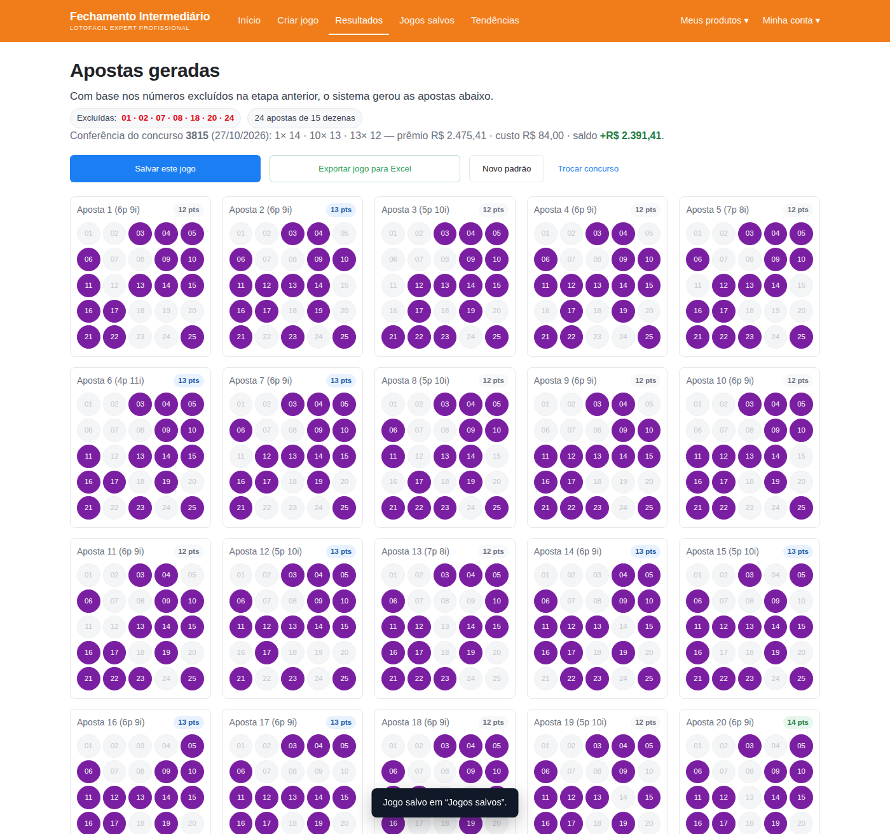

# LotoFácil — Fechamento Intermediário (24 apostas)

Aplicativo web local que implementa a lógica do esboço enviado: o usuário escolhe **7 dezenas
que devem ficar de fora** e o sistema gera **24 apostas de 15 dezenas** usando apenas as 18
dezenas restantes. Sem dependências, sem servidor, sem rede.



## Como abrir

```bash
xdg-open index.html          # abre direto no navegador
# ou, para servir localmente:
npm start                    # http://localhost:8080
```

O estado (seleção, resultado do concurso, jogos salvos e base de tendências) fica no
`localStorage` do navegador.

## A regra do jogo

- Universo: 25 dezenas (1–25).
- O usuário exclui 7 → sobram 18 no **pool**.
- Cada aposta tem 15 dezenas do pool → cada aposta **omite exatamente 3** dezenas do pool.
- 24 apostas distintas, todas de 15 dezenas.

Essa é a dualidade que sustenta o sistema:

```
aposta (15 dezenas)  ↔  trio omitido (3 dezenas)     15 + 3 = 18
escolher 24 apostas  ↔  escolher 24 trios distintos de C(18,3) = 816
```

## O que o sistema garante

Se as **7 exclusões estiverem corretas** (nenhuma delas sorteada):

| Garantia | Valor |
|---|---|
| Pior aposta | 12 pontos |
| Melhor aposta (pior caso) | **14 pontos ou mais, sempre** |
| Participação de cada dezena | 20 das 24 apostas |
| Apostas repetidas | nenhuma |

Se alguma exclusão errar, o pior caso do **melhor** resultado cai:

| Excluídas que saíram | Pior melhor acerto |
|---|---|
| 0 | 14 pontos |
| 1 | 13 pontos |
| 2 | 12 pontos |
| 3 | 11 pontos |
| 4 | 10 pontos (sem prêmio) |

Valores calculados exaustivamente sobre **todas** as combinações possíveis de dezenas não
sorteadas dentro do pool — não é estimativa. Reproduza com `npm run verify`.

Distribuição média com as 7 exclusões corretas (24 apostas):

| 15 pts | 14 pts | 13 pts | 12 pts |
|---|---|---|---|
| 0,03 | 1,32 | 9,26 | 13,38 |

Chance de acertar 15 pontos, dado que as 7 exclusões estão certas: **24/816 ≈ 2,94%**
(existe exatamente 1 trio perfeito entre os 816 possíveis; o sistema cobre 24).

## Como as 24 apostas são escolhidas

Não é sorteio nem heurística: é um desenho combinatório verificável.

1. O pool de 18 é dividido em dois grupos de 9.
2. Em cada grupo aplica-se o plano afim **AG(2,3)**: as 12 retas de 3 pontos formam um
   **sistema de triplas de Steiner STS(9)** — cada par de dezenas aparece em exatamente 1 reta
   e cada dezena em exatamente 4 retas.
3. 2 grupos × 12 retas = **24 trios omitidos**, que viram as 24 apostas.

Consequências diretas:

- cada dezena do pool é omitida 4 vezes → aparece em 20 apostas;
- os 72 pares internos aos grupos são cobertos exatamente uma vez, sem repetição;
- todo conjunto de 3 dezenas não sorteadas contém um par interno (princípio da casa dos
  pombos nos dois grupos) → alguma aposta omite só dezenas não sorteadas → **14 ou 15 pontos**.

A semente (`Novo padrão`) apenas reetiqueta o pool; as garantias são invariantes.

## Conferência e prêmios

Na tela **Criar jogo** informe concurso, data e as 15 dezenas sorteadas. A tabela mostra
quantidade por faixa (11–15 pontos) e o prêmio **subtotal** por faixa, com total — o mesmo
formato do esboço. Os valores unitários por aposta ficam em “Valores de prêmio (editáveis)”,
porque o prêmio real varia a cada concurso.

As apostas também ganham um selo com os acertos e a tela **Resultados** resume a conferência.

## Exportação

“Exportar jogo para Excel” gera **CSV com BOM e separador `;`** (abre direto no Excel pt-BR):
cabeçalho com excluídas/concurso, as 24 linhas de dezenas, acertos por aposta e o resumo de
prêmios. O arquivo é baixado como `lotofacil-<excluidas>-AAAAMMDD.csv`.

## Tendências (heurística, não previsão)

A tela **Tendências** aceita uma base colada de resultados (um concurso por linha, com as 15
dezenas) e mostra frequência por dezena nos últimos 10/20/30/40/50/100 concursos, com marcação
de dezenas quentes/frias. O botão “Usar sugestão” aplica as 7 menos frequentes — é leitura de
histórico, **sem garantia de acerto**; sorteios independentes não têm memória.

## Estrutura

```
index.html              interface (5 telas: Início, Criar, Resultados, Salvos, Tendências)
styles.css              estilos
engine.js               núcleo puro: desenho, geração, pontuação, garantias, CSV
app.js                  estado, navegação, renderização, localStorage
tests/engine.test.mjs   10 testes (estrutura, balanceamento, garantia exaustiva, CSV)
tools/verify_design.py  verificação matemática independente (Python)
tools/ui-smoke.mjs      smoke test de UI via Chrome headless + CDP
docs/screenshots/       capturas das telas
```

## Testes

```bash
npm test          # 10 testes do núcleo (node:test)
npm run verify    # confere o desenho e as garantias em Python
npm run smoke     # dirige a interface no Chrome headless e valida o fluxo completo
```

O smoke test confirma: 7 selecionadas → 24 cartões, garantia visível, conferência do concurso
3815 (13×12, 10×13, 1×14 — idêntico ao esboço), jogo salvo e CSV gerado, sem exceções de
JavaScript.

## Divergências corrigidas do esboço

- Nos prints, cada cartão exibe **18 dezenas**: com 7 excluídas fixas, uma aposta de 15
  dezenas só pode ter 15. O código força 15.
- No print, as 24 apostas aparecem **idênticas** (mesmo padrão de bolinhas). Aqui as 24 são
  distintas, como exige qualquer fechamento.
- A tabela do print (13×12, 10×13, 1×14) é reproduzida exatamente pelo desenho para o concurso
  3815 e as excluídas `01 02 07 08 18 20 24`.

## Limites (honestos)

- **Não prevê sorteio** e não aumenta o valor esperado de nenhuma aposta; organiza cobertura.
- O sistema assume 7 exclusões fixas; não há fechamento com menos/menos dezenas.
- Prêmios exibidos são simulados com valores editáveis.
- “Sugestão” de tendências é heurística, não modelo preditivo.
- Dados ficam só neste navegador (localStorage); “Jogos salvos” não sincroniza entre dispositivos.

Jogue com responsabilidade.
